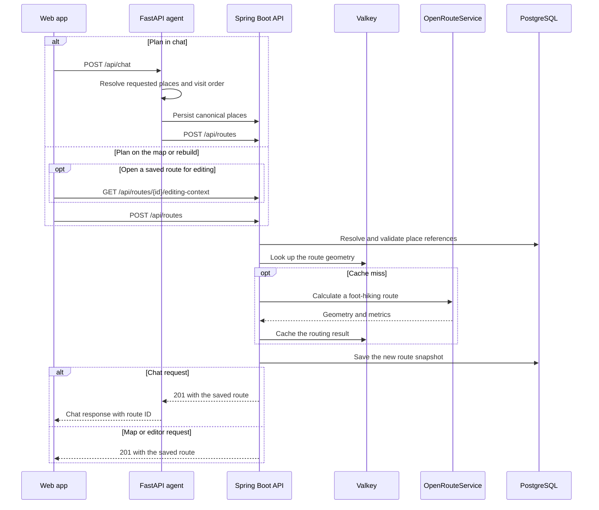

# trego.

trego. is a travel navigator. Describe the places you want to visit or plan on the map,
build a route, and explore landmarks and photos with visible sources along the way.

Use it for city walks, sightseeing and outdoor trips. The current routing implementation
builds **walking routes** with OpenRouteService `foot-hiking`; driving, cycling and
public transport are not implemented. Interests are descriptive, not routing constraints.

## Current capabilities

- Research requested places through Exa and resolve their identities with Nominatim/OSM.
- Create places on the map, build routes, and retrieve saved geometry and metrics.
- Explore sourced place information and verified landmark photos when available.
- Edit a saved route's endpoints and ordered stops, then explicitly rebuild it as a new
  route. The original stays available. Successful manual editing starts a fresh chat session.
- Keep the previous route visible when draft inputs change or rebuilding fails.

Landmark media and the real-service editor are opt-in; follow their service guides
before enabling them. Missing or ambiguous places require clarification, and missing
photos remain an honest empty result. The app does not infer closures from routing failures.

## Architecture


The services use local PostgreSQL and Valkey via Docker Compose or managed instances on Aiven.
The web app talks directly to both services. The Java API owns saved routes and
place data, including routes created through chat.

The two entry points converge on the same route creation API:



The sequence shows a successful route build. Opening the editor reads the
original inputs. Rebuilding saves a new route and keeps the original available.

The [D2 source](docs/architecture/system.d2) can be rendered with D2 v0.9.0:

```sh
d2 --layout=elk --theme=0 --dark-theme=200 docs/architecture/system.d2 docs/architecture/system.svg
```

## Team and repository layout

| Directory | Purpose and stack | Owner |
|---|---|---|
| frontend/ | Map, chat, places, and photos · React, Vite, Tailwind, MapLibre | Daniil · nnatthebest |
| api/ | Places, geospatial queries, saved routes, editing context, landmark media · Java, Spring Boot | Murat · uksus148 |
| agent/ | Chat, Exa research, place resolution, session handling · Python, FastAPI | Mukhamed · dyksookelwe |
| infra/ | Local database and environment checks · Docker Compose | Murat |

Aiven PostgreSQL stores places and routes; PostGIS supports spatial queries. Valkey
caches research/routing results and stores chat sessions. pgvector is available, but
embedding-based ranking is not active. The Java API owns routing and persistence;
the FastAPI agent coordinates research and chat. Kafka events, uploads and photo
embeddings remain deferred.

## Getting started

1. Clone the repository and create a task branch from the current main. Use a descriptive prefix such as feat/, fix/, docs/, infra/, or chore/.
2. Read [CLAUDE.md](CLAUDE.md) for architecture, the API contract, and team tasks.
3. Copy `.env.example` to a root `.env` and fill in values for your service. The template lists shared addresses and empty secret fields.
4. Read [CONTRIBUTING.md](CONTRIBUTING.md) and the [repository rules](docs/REPOSITORY_RULES.md) before opening a PR.

```sh
git clone https://github.com/uksus148/trego. trego
cd trego
cp .env.example .env
```

Local infrastructure provides PostgreSQL 18 with PostGIS and pgvector, plus Valkey,
through Docker Compose with configurable ports. Follow [the infrastructure guide](infra/README.md)
and the service run instructions in [api](api/README.md), [agent](agent/README.md), and
[frontend](frontend/README.md). The integration runbook below distinguishes merged components
from the remaining work and live acceptance.

Aiven Free has been verified with PostgreSQL 18.7, PostGIS 3.6.4, and pgvector 0.8.7. Share service credentials through a private channel. Git ignores the local `.env`.

For backend development, start with the [API code map, run commands, and review order](api/README.md).

Use the [integration runbook](docs/INTEGRATION_RUNBOOK.md) for service coordination
and the [documentation index](docs/README.md) to find current contracts and guides.

For a demo, try a city sightseeing walk or the July Tatras example in the app:
Štrbské Pleso → Skok waterfall → Popradské pleso. Rysy remains a provider-matching
regression, not a guaranteed successful demo. Coverage depends on verified place
identity, provider data and quotas.

## Version and recovery

The third source checkpoint is **v0.3.0**. See [release and recovery](docs/RELEASE_BASELINE.md)
for its tag, earlier checkpoints, recovery commands and database boundaries.
Automated fixture acceptance does not certify live provider coverage or a public deployment.

## Shared contract and project language

The API contract in [CLAUDE.md](CLAUDE.md) and the linked feature contracts define
the implementation. Day planning, personalization and additional transport modes
require a separate agreed design. Affected developers record shared decisions in CLAUDE.md.

English is the project language for repository files, code comments, documentation, commits, PRs, and reviews.

## License

The project code is distributed under [MIT](LICENSE).
